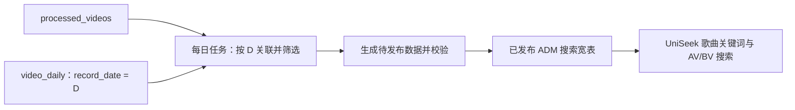

# UniSeek 子设计：每日生成 ADM 歌曲搜索宽表

创建日期：2026-10-31。更新日期：2026-11-04。状态：开发者已完成宽表首批构建并运行新查询，代码与本地回归完成，已收到响应样本；待完善每日运行与分布性能验收。

2026-11-03 用户确认搜索宽表已有数据，截图客户端显示 72,992 行。歌曲关键词与 AV/BV 查询已改读该表，开发者随后反馈新路径首次视频响应约 700 ms、后续下滑约 100 ms。本轮未连接业务数据库，CRON 注册和日常日期确认接入尚未核实；没有上游完成标记时仍采用显式确认数据日。执行版、授权与操作顺序见 [SQL 使用说明](../../../sql/adm_uniseek_videos.md)。

父文档：[UniSeek beta 接口与现状](../../../frontend/src/services/UniSeek/uniseek.md)。执行入口：[ADM 搜索宽表 TODO](../../todo/uniseek-adm-search-snapshot.md)。分工与结果：[技改复盘](adm-search-retrospective.md)。

## 1. 背景与评估依据

迁移前 UniSeek 歌曲查询先从 `hantang_dynamic.processed_videos` 召回最多 1,000 个文字候选，再关联最新有数据日的 `hantang_dynamic.video_daily`，过滤该日点赞数大于 10 的视频。静态表规模大，历史日指标使用 Timescale 压缩，在线关联、候选评分与读取数据共同影响冷查询耗时。

业务已明确只关心有一定流量的投稿。新方案将歌曲的收录门槛提高为 **选定快照日累计点赞数严格大于 100**，离线完成关联与筛选，生成面向 UniSeek 的 ADM 搜索宽表，在线直接读取标题、标签、封面及指标。

评估输入及其边界：

- 用户在非生产用途的 `video_daily_latest` 中查询点赞数大于 100，得到约 23.78 万行。这个数字只用于估算容量，正式来源不使用这张表。
- 此前只读检查中 `processed_videos` 的统计估算约为 823 万行。与 23.78 万比较，规模约缩小 35 倍；不能据此承诺查询延迟同比缩短。
- 用户首批实际生成结果的客户端截图为 72,992 行，和早期单表估算不具有相同筛选口径；后续规模以每次发布信息为准。开发者已提供响应样本，Codex 未独立连接业务库核查或测量。

## 2. 已确认范围与待定选择

已确认的业务方向：

- 每日由 CRON 触发离线任务，关联歌曲静态信息与选定日期的 Daily 数据。
- 正式数据源为 `processed_videos` 和 `video_daily WHERE record_date = D`，不使用 `video_daily_latest` 或 `video_static`。
- 仅纳入未删除、在 D 日存在快照且 D 日累计点赞数大于 100 的视频；100、0、NULL 均不满足门槛。
- 搜索表冗余所需指标，UniSeek 歌曲关键词与 AV/BV 搜索都只从已发布搜索数据读取，在线不再关联原始静态表与 Daily。
- 保持歌手本地搜索、UP 主独立搜索、结果按到达顺序追加及歌曲分页的交互。

本次 SQL 采用普通表 `hantang_dynamic.adm_uniseek_videos`，配合单行 `adm_uniseek_refresh_state` 管理确认和发布。删除资格保持 `is_deleted = false`，NULL 不入表。物化视图的选型讨论保留于第 6 节。应用查询统一读取已按大于 100 门槛发布的表，不另行读取原始表或采用原在线大于 10 的规则；运行服务需部署新版后端。

## 3. 数据流与逻辑粒度

逻辑粒度为 **每个 aid 一行，只提供当前已发布批次的搜索数据**，不在在线搜索表中积累逐日历史；同一视频的分 P、歌手和标签不会展开成多行。它是应用层搜索明细，不是现有 `adm_entity_metrics_daily` 聚合统计表的新维度。

数据分组如下，具体列名、类型与约束以建表 SQL 为准：

- 标识及展示：aid、bvid、title、pic、pubdate、user_id。
- 检索字段：tag_new、participle、label_singers，延续现有搜索语义。
- 累计指标：view、favorite、like、coin、share、reply、danmaku，统一取 D 日对应快照。
- 来源与发布信息：record_date、batch_id、refreshed_at；是否增加规则版本字段待定。

只复制实际检索、展示和排序所需字段，不采用 `SELECT p.*`；本期不因为建宽表而自动纳入 description、extras、notes 等大字段。其他指标的 NULL 保持缺失，真实 0 保持 0；不得从旧日期补齐或以 0 替代缺失。点赞数缺失的视频不入表。

正式字段、约束、索引与注释统一维护在 [sql/adm_uniseek_videos.sql](../../../sql/adm_uniseek_videos.sql)，完整无空行安装版为 [adm_uniseek_videos_install.sql](../../../sql/adm_uniseek_videos_install.sql)，遵循 [PostgreSQL 表文档约定](../../rule/postgresql-ddl.md)。本文不重复维护具体结构定义。

## 4. 日期选择与每日刷新

D 应是 **最新已完成采集与入库、通过发布校验的数据日期**，不是简单取今天，也不是每个 aid 各自的最后一天。无论 D 距今天多久，所有搜索指标都使用同一 D。

用户已确认暂时没有上游完成标记。本次采用显式 `adm_confirm_uniseek_source_date(D)` 声明该日入库完成，并记录行数用于漂移校验；同日重新确认生成新批次。CRON 每 10 分钟检查一次，有新确认才刷新。用户观察到 Daily 常见情况是某日无记录或约 60 多万行，但这不是已核实的数据完整性协议；行数或 `MAX(record_date)` 均不能单独证明整批入库完成。

每日任务建议流程：

1. 确认可用日期 D 及其上游完成状态，获取刷新任务的互斥资格，避免慢任务覆盖新批次。
2. 以 D 为固定参数，执行 INNER JOIN、未删除过滤和点赞数大于 100 的筛选，生成待发布数据。
3. 校验数据日期、aid 唯一性、业务条件、缺失情况和结果规模；规模异常时与上一个健康批次比较，阈值待实测后确定。
4. 校验成功后原子发布新批次，同时记录来源日期、完成时间与结果数量。
5. 在同一发布事务更新批次元数据及查询统计信息；提交后，应用从搜索表读到新批次便不再使用旧批次缓存。

不预设具体执行时刻，日期确认应排在 Daily 入库完成之后。调度 SQL 每 10 分钟检查，失败后下轮重试；生产注册状态、重试次数限制与监控仍待核实。任务失败、无已完成新日期或结果校验异常时，继续提供上一个成功批次，不先清空在线表。

对同一个 D 的重跑应幂等，以重新计算的完整结果覆盖旧结果，不在旧指标上累加。迟到数据、指标修正、视频删除及跌回门槛以下的情况均通过重算反映；不能只做 INSERT 而永不移除失效记录。原始 Daily 同日同 aid 重复时应报错或阻止发布，不用 DISTINCT 随意消歧。

## 5. 发布、查询与缓存

普通表方案保持在线对象、索引及权限稳定。先在临时表准备和验证数据，再在同一事务中 DELETE / INSERT 正式表并更新发布信息，单条 SELECT 只能看到一个完整的已发布版本。失败回滚保留旧批次，不采用在线 TRUNCATE 后逐步填充，或逐日 DROP / 重建在线表。

关键词及编号入口必须遵循相同的搜索资格，不通过原始表查询绕过大于 100 的门槛。未进入搜索集的编号正常返回空结果，不将其等同于视频在原始库中不存在；详情页资料接口的范围不在本期扩大或收缩。

接口沿用 list、hasMore、nextPage、page/pageSize 契约，page 从 1 开始，默认 30 首、最大 50 首。SQL 对 ADM 所有文字匹配项评分排序后才 LIMIT 1,000，服务端按原顺序切页。1,000 首是 beta 返回上限，不再是关联前的候选上限；后续按性能与产品需求评估是否取消。

标题支持包括一、二字在内的 ILIKE 子串，数组保持完整元素匹配；空白分隔的每个词均需匹配标题或一组数组。临时评分保留标题档位、长度接近度及最多 40 分的对数播放量加分，最终 score DESC、aid DESC；不做跨类型排序。指标已在同表，无需关联后再打分；不在本次冻结正式排序函数。

结果缓存按关键词与发布 UUID 区分，有效期 60 秒、最多 16 个键、每键最多 1,000 首。每页从 ADM 读取一行 batch_id 来检查缓存；未命中时以排序 SQL 实际返回的批次写缓存，处理两次读取间发生发布的情况。无匹配不缓存，空表返回空数组并清空缓存；缺表、权限或查询失败仍返回错误。同日补算生成新 UUID，不能只以 record_date 判断更新。

关键词与编号查询均不再探测或 JOIN 历史 Daily，recordDate 使用已发布来源日。固定批次游标尚未实现，跨发布或缓存过期的连续翻页仍可能漂移，由前端去重；不能把单条 SQL 的批次一致性当成整个翻页会话的快照保证。

## 6. 普通 ADM 表与物化视图

推荐普通 ADM 表，便于以明确的 D 进行补算、校验和批次发布，并逐步接入任务状态管理。首期按每日全量生成估算刷新成本，暂不设计复杂增量同步。

PostgreSQL 原生支持物化视图：结果实际存储、可建索引，查询时直接读取已保存结果。若规则长期固定且刷新控制简单，可以用物化视图承载同一逻辑数据集；它并不天然比相同数据与索引的普通表查询更慢。

物化视图普通刷新可能阻塞读取；并发刷新需要已填充数据和覆盖全部行的普通列唯一索引，例如 aid 唯一索引。并发刷新也会重新执行定义查询，不应当作自动增量维护。物化视图同样需要在刷新前确认数据日期与入库完成，不能依赖一个随时变化的最大日期直接发布不完整批次。

两种实现都应以失败不发布、读完整批次为目标。选择普通表或物化视图不是数据规模收益的来源，收益主要来自预先过滤、冗余必要数据以及消除在线关联。

## 7. 索引与性能验证

2026-11-03 用户执行旧安装版时遇到扩展创建权限错误，并明确要求不使用 pg_trgm。本版只保留 PostgreSQL 内置的 aid 主键、bvid 唯一索引及标签/分词/歌手数组 GIN，不创建扩展或标题 trigram 索引。是否需要投稿时间或播放量等 B-tree 索引，按最终查询方式与执行计划决定，不默认复制原表全部索引。

标题子串匹配直接使用 ILIKE，可能扫描整个 ADM 小表；普通 B-tree 无法替代此前的 trigram 子串索引。小表只降低扫描成本，不自动解决所有分词、别名或相似度问题。保留原始数组字段及内置 GIN，避免上线时无意丢失现有召回能力。

目前留存的旧路径热门二字词未缓存首查约 3–4 秒，开发者反馈新路径首次约 700 ms、后续翻页约 100 ms；首次粗比提速约 4.3–5.7 倍。关键词和负载条件未统一，详细来源、日期定位子步骤及比较限制见 [复盘](adm-search-retrospective.md)。这不构成 P50/P95 或纯 SQL 基准，也没有重跑旧逻辑。

后续以新路径为主记录不同词与并发下的响应分布、扫描行数、缓冲区读取、排序成本和资格一致性，同时记录每日生成、索引维护、发布耗时及临时磁盘占用。旧路径使用已留存聊天样本作参考，不为补齐数据重新运行。

## 8. 部署与待验收

首批表和数据由开发者执行并确认完成；应用代码及本地回归已完成，开发者已运行新版查询并反馈响应。独立 Java 账号的 schema USAGE 与宽表 SELECT 授权已补入操作说明。日常运行仍需核实源数据唯一性、合理的最少结果行数阈值、维护账号权限及 CRON 注册。调度默认每 10 分钟检查待发布请求，失败下轮重试；重试次数限制与监控待完善。

本地 SQL 回归已验证离线发布和回滚，以及不创建原始视频/Daily 表时实际 DAO 查询的匹配、评分、编号和分页；Java 回归验证批次缓存、发布读取交错及独立 HTTP 响应。已有开发者反馈的响应样本，业务环境的分布延迟、多连接锁等待与每日任务持续运行仍需验收。

验收至少覆盖：

- 所有结果来自同一已发布 D；今天无数据、较早历史 D、日期中间断档均正确处理。
- 101 赞入表，100、0、NULL 不入表；已删除、缺静态信息、缺 D 日快照的视频不入表。
- 其他指标的 NULL 与真实 0 可区分；不跨日期补指标；原始重复记录阻止发布。
- 刷新失败或校验异常时旧批次仍可查；刷新期间无半批结果；同日补算正确替换并移除失效记录。
- 关键词与 AV/BV 搜索资格一致；歌手和 UP 主搜索、并发到达展示、去重与分页行为保持可用。
- 新请求读到新批次后不再复用旧缓存；同日重算同样生效，查询实际批次不会被发布前的探测值误标。
- 用执行计划验证在线歌曲查询只读取 ADM 搜索数据，不回源 JOIN 原始歌曲与 Daily。

发布验证失败时保留旧成功批次。应用没有自动回源开关；若部署后需要回退，应明确评估旧版本的收录口径并回退应用版本，不能隐式查询原表绕过门槛。

## 9. 与后续工作的关系

本项目是 PostgreSQL 内部的搜索数据准备层，和 [Elasticsearch / 正式排序待办](../../todo/uniseek-elasticsearch-ranking.md) 分开跟踪。实现 ADM 不等于开始 Elasticsearch 迁移，也不自动扩大本期搜索字段范围；是否把 ADM 作为未来索引的数据来源，在后续设计中再确定。

## 参考

- [当前 UniSeekDao](../../../src/main/java/com/hantang/web/dao/UniSeekDao.java)、[实际查询 SQL 回归](../../../sql/tests/uniseek.test.mjs)、[ADM SQL 与部署](../../../sql/adm_uniseek_videos.md)。原最新日期探测已移除，原表搜索索引不是新路径的部署前置。
- [视频与账号数据源约定](../../../sql/video_creator_reference.md)、[ADM 日任务方案](../adm-postgresql-aggregation.md)；现有日任务的部署状态不代表本搜索任务已创建或已注册。
- [PostgreSQL 18 物化视图](https://www.postgresql.org/docs/18/rules-materializedviews.html)、[物化视图刷新](https://www.postgresql.org/docs/18/sql-refreshmaterializedview.html)。
