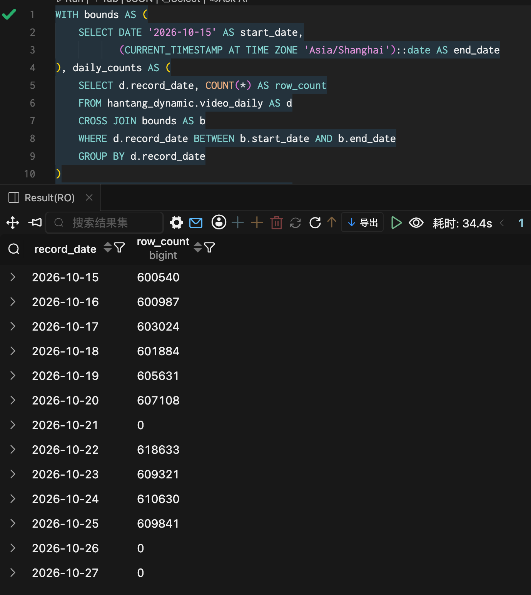

# MySQL 到 PostgreSQL 同步数据缺失

状态：已确认、待外部 owner 修复。记录日期：2026-10-27。

## 已确认问题

用户于2026-10-27明确确认：当前已知的一项数据缺失问题发生在 MySQL 同步数据到 PostgreSQL 的环节。同步程序位于另一 Git 仓库，由另一位 owner 负责；具体仓库地址、owner 标识、故障机制及修复时间尚未提供。

本记录跟踪该外部依赖。同步归因依据用户确认，下面的 PostgreSQL 查询结果用于记录缺失现象，不代替对同步程序的根因排查。

## 查询证据

用户提供的截图按 `record_date` 检查 `hantang_dynamic.video_daily`，范围为2026-10-15至北京时间2026-10-27。截图中的关键结果：

- 2026-10-20：607108条；2026-10-21：0条；2026-10-22：618633条，区间内部存在整日缺口。
- 2026-10-25：609841条，最新证据已显示该日有数据，取代此前该日无记录的观察；该行数本身不证明所有作品及指标均已完整。
- 2026-10-26、2026-10-27：均为0条。27日为查询当日，结果仅代表截图时点状态，后续以复核结果更新。

这里的0表示目标表没有该日记录，不表示视频累计播放量、收藏量或日增量为0。本次仅依据用户提供的截图记录事实，未连接业务库复查 MySQL 或 PostgreSQL。

## 责任范围与期望结果

数据同步所在仓库的 owner 负责定位并修复漏同步问题、核对 MySQL 与 PostgreSQL 的差异、补齐历史缺失数据，并确认后续同步结果。数据爬取、数据同步和上游数据预处理均不属于本项目的实施职责。

本项目负责查询前后端：识别必要快照缺失或不完整，保留NULL和日期，避免产生虚假零值或极端增量；待上游确认修复及补数后，验证查询与展示恢复。Web已处理缺失值，不等于同步链路已修复。

## 外部依赖与后续验证

- [ ] 记录同步仓库及负责owner，补充其问题或修复记录链接。
- [ ] 由外部owner确认具体漏同步机制、受影响的日期和对象范围。
- [ ] 由外部owner完成同步修复与历史补数，并提供源端和目标端的核对结果。
- [ ] 本项目复核必要日期、样本和指标的完整性；记录数大于0不直接等同于数据完整。
- [ ] 本项目验证中术50逐日增量与前端断点恢复，复核依赖受影响快照的聚合结果是否需要重算。

相关：[Web数据缺失识别与展示](web-missing-data-handling.md)、[ADM日聚合待办](adm-daily-aggregation.md)、[项目职责](../../README.md)。
